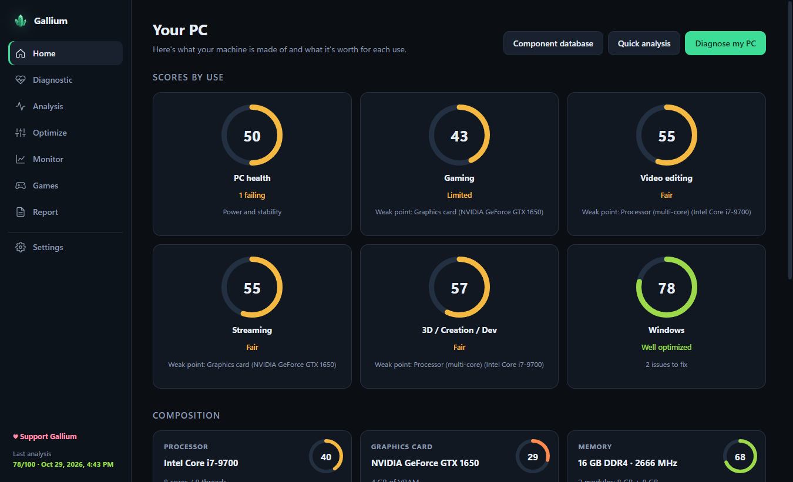
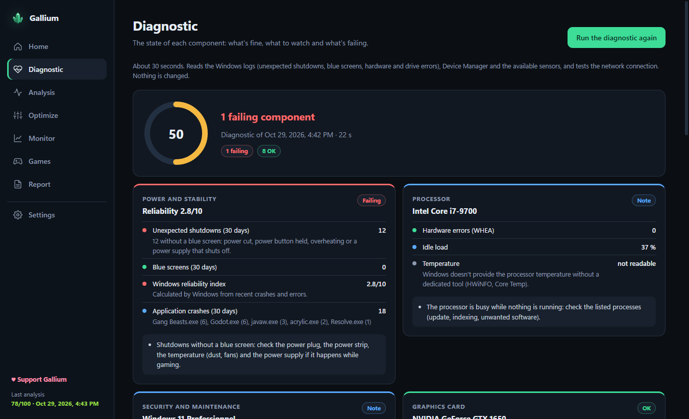
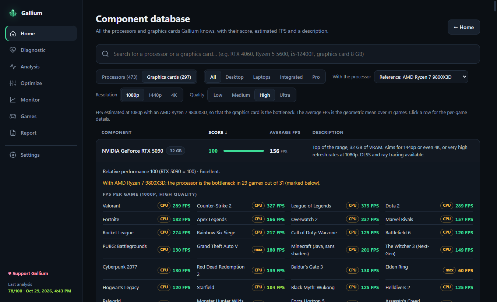

<div align="center">


# Gallium

**Diagnose, analyze and optimize your Windows PC — free and open source.**

[](LICENSE.txt)


[](https://ko-fi.com/galliumpc)

[**⬇ Download**](https://github.com/FrenchWith0Skill/gallium/releases/latest) · [Contributing](CONTRIBUTING.md) · [Français](#français)



</div>

## What Gallium does

In 30 seconds, Gallium tells you **what's fine, what to watch and what's failing** in your PC — and how to fix it.

- 🩺 **Health diagnostic** of every component: processor, graphics card, memory, every drive (SMART), battery, network and drivers. Blue screens and unexpected shutdowns are explained, along with the component most likely at fault.
- 🧪 **Stability tests**: processor at 100%, graphics card, RAM check without restarting or the full Windows memory test at startup.
- ⚡ **One-click, reversible optimizations**: power plan, Game Mode, mouse acceleration, temporary files… A restore point is created before the first change.
- 📊 **A score for every component**, estimated FPS in about thirty games, and a **database of 470 processors and 300 graphics cards** to compare or plan an upgrade.
- 📈 **Real-time monitor**: processor, memory, graphics card, temperature and network.
- 🛠️ **Professional mode** for repair shops: PDF reports for your clients, client records with multi-PC history, and a detailed driver list.

<p align="center">
  
  
</p>

## Download

Go to [**Releases**](https://github.com/FrenchWith0Skill/gallium/releases/latest) and pick:

- `Gallium-Setup-x.y.z.exe` — the installer;
- `Gallium-Portable-x.y.z.exe` — the portable version, no installation needed (handy on a USB stick).

Good to know:

- Gallium needs **administrator rights** to read drive health and the Windows event logs.
- The executable is not code-signed yet: if Windows shows *"Windows protected your PC"*, click **More info → Run anyway**. The source code is right here, so you can check exactly what it does.
- Scores and FPS figures are **estimates**, not measurements.
- The interface is available in **20 languages** (Settings → Language, or on the first screen).

## Privacy

Gallium runs **entirely on your PC** and sends no data. The only network traffic is a ping to your router and to 1.1.1.1 (Cloudflare) to measure latency. Optimizations only change your Windows account settings and can be undone.

## Support the project ☕

Gallium is free and will stay free. If it helps you, you can buy me a coffee on [**Ko-fi**](https://ko-fi.com/galliumpc) — the app's *Support Gallium* button leads there too. A ⭐ on the repository helps a lot as well!

## Build from source

Requirements: [Node.js](https://nodejs.org) 18 or newer, Windows 10 / 11.

```bash
npm install
npm start          # run the app
npm test           # check the scoring engine
npm run dist       # build the installer and the portable version into dist/
```

Technical documentation (architecture, translations, component database) is in [docs/DEVELOPMENT.md](docs/DEVELOPMENT.md).

## Contributing

Bug reports, translation fixes and new components are welcome — see [CONTRIBUTING.md](CONTRIBUTING.md).

## License

Copyright (C) 2026 FrenchWith0Skill

Gallium is free software: you can redistribute it and/or modify it under the terms of the **GNU General Public License version 3** as published by the Free Software Foundation. It is distributed in the hope that it will be useful, but **without any warranty**. See [LICENSE.txt](LICENSE.txt).

Gallium uses open-source software under their own licenses: Electron (MIT), Chromium (BSD and others) and systeminformation (MIT).

---

## Français

**Gallium** te dit en 30 secondes ce qui va bien, ce qui est à surveiller et ce qui est défaillant dans ton PC Windows, et comment le corriger.

Au programme :
- un diagnostic de santé de chaque composant, avec les écrans bleus expliqués ;
- des tests de stabilité processeur, mémoire et carte graphique ;
- des optimisations réversibles en un clic ;
- un score par composant et les FPS estimés dans une trentaine de jeux ;
- un moniteur en temps réel ;
- un mode Professionnel pour les réparateurs.

**Téléchargement** : l'installateur ou la version portable se trouvent dans [Releases](https://github.com/FrenchWith0Skill/gallium/releases/latest).
- Gallium demande les droits administrateur.
- L'application n'est pas encore signée : sur l'avertissement SmartScreen, clique sur *Informations complémentaires → Exécuter quand même*.
- Elle fonctionne entièrement sur ton PC et n'envoie aucune donnée.
- Pour la passer en français : Paramètres → Langue.

**Soutenir** le projet : [Ko-fi](https://ko-fi.com/galliumpc) ☕. Gallium est gratuit et le restera.

Licence **GNU GPL v3** : voir [LICENSE.txt](LICENSE.txt).
